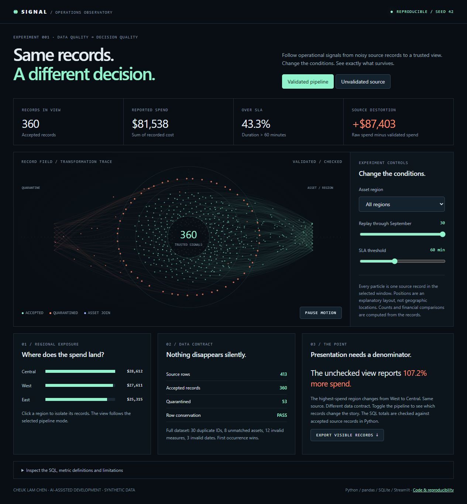

# Signal / Operations Observatory

**Same records. A different decision.** An interactive demonstration of how data
quality changes an operational report, built by Cheuk Lam Chen with AI assistance.
Created October 22, 2026 as a focused portfolio demonstration.



## Run it

```bash
python -m venv .venv
# Activate the virtual environment for your platform.
python -m pip install -r requirements.txt
python -m unittest -v
python pipeline.py
python -m streamlit run app.py
```

The generated `docs/index.html` also runs directly in a browser, without an API
key or Python server. It embeds a deterministic snapshot exported by the Python
pipeline. Run `python pipeline.py` after changing the data or HTML source.

## Try the experiment

1. Switch between **Validated pipeline** and **Unvalidated source**. Watch the
   spend and record counts change as quarantined records leave the analysis.
2. Filter a region or replay the first N September days. The metrics, bars and
   animated record field update together.
3. Change the SLA threshold. The breach rate is recalculated from records with
   a numeric duration, not a decorative animation or hard-coded percentage.
4. Inspect the SQL, download visible records, and review rejected records in
   the local Streamlit transformation audit.

## What is implemented

- Seeded synthetic utility operations and a unique-key asset dimension.
- pandas validation, stable first-occurrence deduplication, quarantine reasons,
  numeric and date checks, and a validated many-to-one asset join.
- SQLite regional and daily aggregations with source-to-SQL reconciliation.
- A Canvas record-field visualization, responsive controls, CSV export and
  reduced-motion support. Each particle represents a source record; its position
  is an explanatory layout, not a geographic location or physical simulation.
- A Streamlit shell exposing the interactive observatory, audit and underlying
  accepted records. The static browser view computes filter and SLA metrics in
  JavaScript from the same exported records; Python tests check the source model.

## Data contract and metric definitions

All 413 input rows are synthetic. The default seed yields 360 accepted records
and 53 quarantined records: 30 duplicate IDs, 8 unmatched assets, 12 missing or
negative measures, and 3 invalid dates. Every input row is accounted for.

The first event ID occurrence wins. Later occurrences are quarantined rather
than interpreted as corrections; a production ingestion system would need an
explicit version/timestamp policy. Rejected rows are retained for inspection.
Spend is the sum of recorded cost. SLA breach rate is the proportion of numeric
durations strictly above the selected threshold. Raw mode deliberately includes
defects, including invalid dates; validated mode excludes quarantined records.
Unknown asset keys appear only in the raw all-regions comparison.

## Limitations

This is a local and static portfolio demonstration using synthetic data, not
employer data, a deployed utility platform, predictive model or production
system. Financial differences demonstrate this data contract, not real savings.
No Power BI experience, production scale or clinical capability is implied.

## Interview walkthrough

The business question is whether noisy source records change a regional
operations decision. Explain the duplicate policy, show why a many-to-one join
matters, then switch views to connect the defect count to reported spend.
Demonstrate one filter and trace its results back to accepted rows. Discuss what
would change for real data: correction semantics, durable ingestion, schemas,
authentication, data freshness and stakeholder-defined SLA rules.

AI helped implement this demonstration. Cheuk directed its purpose and
requirements. The project does not establish independent mastery of every
dependency; understanding and extending it are part of interview preparation.
